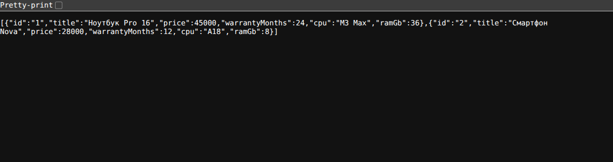

# Практична робота № 4 — REST API на NestJS

## Варіант 1: електроніка та гаджети

Ресурс: `/gadgets`. Сутність містить поля `title`, `price`, `warrantyMonths`, `cpu` та `ramGb`.

## Запуск

Поточний стек NestJS 11/Vite 8 потребує Node.js 20.19 або новішої версії. Це вище за Node 18+
у початковому описі завдання: актуальні сумісні залежності NestJS вимагають Node 20+.

```bash
npm install --legacy-peer-deps
npm run start:dev
```

Сервер слухає порт `3000`. Перелік запитів для REST Client або Thunder Client є у файлі
[requests.http](./requests.http).

## Перебіг виконання

### Рівень 1 — базові ендпоінти (виконано)

- NestJS-проєкт створено через Nest CLI з TypeScript `strict` mode.
- `GadgetsController` згенеровано CLI та зареєстровано в `AppModule`.
- Створено DTO `CreateGadgetDto` і `UpdateGadgetDto`.
- Реалізовано `GET /gadgets`, `GET /gadgets/:id` і `POST /gadgets`.
- Додано два початкові записи для перевірки читання; `POST` повертає запис з ID.

**Пояснення:** декоратори `@Get`, `@Post`, `@Param` і `@Body` описують маршрути та зв'язують
параметри HTTP-запиту з аргументами методів. DTO-класи визначають контракт даних гаджета.
На першому рівні тестові записи тимчасово зберігалися в контролері; на другому рівні сховище
було перенесено в окремий сервіс.

### Рівень 2 — CRUD і сервіс (виконано)

- Бізнес-логіку та in-memory масив із двома початковими записами перенесено в `GadgetsService`.
- Контролер отримує сервіс через constructor injection; сервіс зареєстровано в `AppModule`.
- Реалізовано `GET`, `POST`, `PATCH` і `DELETE`; ID нових гаджетів генерується через `randomUUID()`.
- Відсутній запис спричиняє `NotFoundException`; `POST` повертає `201 Created`, `DELETE` — `204 No Content`.
- Додано unit-тести для CRUD і помилок пошуку.

**Пояснення:** NestJS створює `GadgetsService` і передає його контролеру через конструктор.
Сервіс відповідає за стан даних, часткове оновлення та перевірку наявності ID. `NotFoundException`
автоматично перетворюється на HTTP-відповідь `404 Not Found`.

### Рівень 3 — пошук, заголовки та тестування (виконано)

- `GET /gadgets?search=...` шукає в назві без урахування регістру.
- `GET /gadgets?limit=...` обмежує кількість результатів; непозитивне чи неціле значення повертає `400 Bad Request`.
- `GET /gadgets` додає заголовки `X-API-Version: 1.0` і `X-Service-Status: operational`.
- `npm run build`, `npm test` (5 тестів) і `npm run lint` успішні.
- `npm audit --omit=dev` не виявив вразливостей у production-залежностях; повний audit показує три помірні advisories у dev CLI/tooling.

**Пояснення:** query-параметри є рядками, тому сервіс перетворює `limit` на число та перевіряє,
що це додатне ціле значення. Невалідний ввід не ігнорується, а повертає `400`. Декоратори
`@Header()` додають службові заголовки саме до відповіді списку.

## Результати HTTP-перевірок

| Запит | Результат |
|---|---|
| `GET /gadgets` | `200 OK`, список із двох тестових гаджетів і обидва службові заголовки |
| `GET /gadgets?search=НОУТБУК` | `200 OK`, фільтр без урахування регістру |
| `GET /gadgets?limit=1` | `200 OK`, один запис |
| `GET /gadgets?limit=0` | `400 Bad Request` |
| `GET /gadgets/1` | `200 OK`, знайдений гаджет |
| `GET /gadgets/99999` | `404 Not Found` з повідомленням |
| `POST /gadgets` з валідним JSON | `201 Created`, UUID у відповіді |
| `PATCH /gadgets/1` | `200 OK`, змінено лише передане поле |
| `DELETE /gadgets/1` | `204 No Content`, без тіла відповіді |

**Скріншот успішної відповіді API:**



## Контрольні питання

1. **IoC і DI:** Inversion of Control передає керування створенням залежностей фреймворку. У NestJS контейнер створює провайдери й передає їх у конструктори залежних класів.
2. **Модуль, контролер, провайдер:** `@Module` групує компоненти; `@Controller` маршрутизує HTTP-запити; `@Injectable` позначає клас, яким може керувати DI-контейнер.
3. **DTO-класи:** на відміну від інтерфейсів, класи існують під час виконання JavaScript і можуть використовуватися для метаданих та рантайм-валідації.
4. **Параметри запиту:** `@Param('id')` читає параметр маршруту, `@Query('search')` — query, `@Body()` — тіло запиту.
5. **HTTP-статуси:** стандартні відповіді NestJS — `GET 200`, `POST 201`, `DELETE 200`; `@HttpCode()` задає інший статус, тут `POST 201` і `DELETE 204`.
6. **Винятки:** exception layer перетворює `NotFoundException` на JSON-відповідь із кодом `404`, повідомленням і назвою помилки.
7. **Кастомні заголовки:** `@Header('X-API-Version', '1.0')` додає заголовок до HTTP-відповіді методу.
8. **PUT і PATCH:** `PUT` зазвичай замінює весь ресурс, тоді як `PATCH` змінює лише передані поля.

In-memory записи повертаються до початкового стану після перезапуску сервера.
